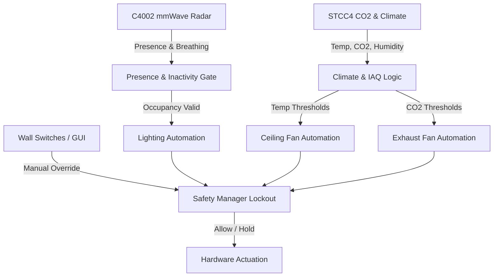

# ESP32-C6 Smart Home Room Controller - Complete User Manual & Feature Guide

> **Tech Panda Smart Home Automation & IoT Hardware Project**  
> **Target Microcontroller:** ESP32-C6-WROOM-1 (32-bit RISC-V @ 160MHz)  
> **Firmware Framework:** Arduino on PlatformIO  
> **Storage & UI Engine:** LittleFS on 16MB Winbond External SPI Flash (`W25Q128`) + Asynchronous WebSockets  
> **Official Channel:** [Tech Panda YouTube](https://www.youtube.com/@TechPanda-4k)

---

## 📖 Table of Contents
1. [System Overview & Architecture](#1-system-overview--architecture)
2. [Hardware Pinout & Wiring Map](#2-hardware-pinout--wiring-map)
3. [Network Connectivity & Initial Setup](#3-network-connectivity--initial-setup)
4. [Dashboard UI & Controls Breakdown](#4-dashboard-ui--controls-breakdown)
   - [Top Navigation Cyber Header](#41-top-navigation-cyber-header)
   - [6-Channel Switchable Relays](#42-6-channel-switchable-relays)
   - [Dual Fan Speed Controllers (Triac + Relay Interlock)](#43-dual-fan-speed-controllers-triac--relay-interlock)
   - [Environmental & Presence Intelligence (STCC4 & C4002)](#44-environmental--presence-intelligence-stcc4--c4002)
   - [AC Power & Energy Monitor (ACS37800 + Winbond Logger)](#45-ac-power--energy-monitor-acs37800--winbond-logger)
5. [Smart Automation Engine & How It Works](#5-smart-automation-engine--how-it-works)
   - [Presence & Inactivity Gate](#51-presence--inactivity-gate)
   - [6-Channel Lighting Automation Modes](#52-6-channel-lighting-automation-modes)
   - [Ceiling Fan (Fan 1) Climate Automation](#53-ceiling-fan-fan-1-climate-automation)
   - [Exhaust Fan (Fan 2) IAQ Automation](#54-exhaust-fan-fan-2-iaq-automation)
   - [Smart Scenarios (Night Quiet & Air Boost)](#55-smart-scenarios-night-quiet--air-boost)
   - [One-Click Scenario Presets](#56-one-click-scenario-presets)
6. [Industrial Automation Safety Engine](#6-industrial-automation-safety-engine)
   - [Anti-Rapid-Cycling & Hysteresis](#61-anti-rapid-cycling--hysteresis)
   - [Manual Intervention & 30-Minute Lockout](#62-manual-intervention--30-minute-lockout)
   - [Power Glitch & Boot Stabilization](#63-power-glitch--boot-stabilization)
7. [Settings Modal - Tab-by-Tab Configuration](#7-settings-modal---tab-by-tab-configuration)
   - [Tab 1: Automation Settings](#tab-1-automation-settings)
   - [Tab 2: Lights & Power](#tab-2-lights--power)
   - [Tab 3: Wi-Fi Network Manager](#tab-3-wi-fi-network-manager)
   - [Tab 4: Home Assistant & MQTT](#tab-4-home-assistant--mqtt)
   - [Tab 5: OTA Firmware & Filesystem Updates](#tab-5-ota-firmware--filesystem-updates)
   - [Tab 6: System Info & Specifications](#tab-6-system-info--specifications)
8. [Home Assistant Integration (Zero-YAML MQTT Auto-Discovery)](#8-home-assistant-integration-zero-yaml-mqtt-auto-discovery)
   - [Supported Entities & Controls](#81-supported-entities--controls)
   - [MQTT Topic Reference Map](#82-mqtt-topic-reference-map)
   - [Quick Step-by-Step Connection Guide](#83-quick-step-by-step-connection-guide)
9. [Hardware Controls (Rotary Encoders & Wall Switches)](#9-hardware-controls-rotary-encoders--wall-switches)
10. [OTA Flashing & PlatformIO Build Guide](#10-ota-flashing--platformio-build-guide)

---

## 1. System Overview & Architecture

The **ESP32-C6 Smart Home Room Controller** is a high-performance, non-blocking automation hub engineered for residential rooms, home offices, and commercial facilities. It merges environmental sensing, human presence radar, high-precision power metering, AC phase-cut dimming, and relay switching into a unified hardware and web interface.

### Key Capabilities:
- **True Human Presence & Respiration Radar:** 24 GHz millimeter-wave radar detects even motionless humans breathing.
- **True NDIR/Photoacoustic CO₂ & Climate Sensing:** STCC4 sensor tracks $CO_2$ ppm, ambient temperature, and relative humidity.
- **Isolated AC Phase-Cut Fan Control:** Dual Triac (MOC3052 + BT139/BTA16) with zero-cross interrupt gating and mechanical relay isolation for silent inductive loads.
- **Galvanically Isolated Power Metering:** Allegro ACS37800 Hall-effect power monitor tracking Voltage, Current, Active Power, Apparent Power, and Power Factor.
- **External Flash Long-Term Logging:** High-capacity 16 MB Winbond SPI flash records 5-minute interval energy records for rolling 7-day logs without stressing internal ESP32 flash.
- **Zero-Latency WebSocket Architecture:** All web controls sync bi-directionally across multiple browsers and mobile screens simultaneously in under 20 milliseconds.

---

## 2. Hardware Pinout & Wiring Map

| Subsystem / Peripheral | Signal | ESP32-C6 GPIO | Notes / Interface |
| :--- | :--- | :--- | :--- |
| **I2C Bus (Shared)** | SDA | `GPIO 6` | 400 kHz Fast-Mode (MCP23017, ACS37800, STCC4) |
| | SCL | `GPIO 7` | 4.7kΩ Pull-ups to 3.3V |
| **I/O Expander (MCP23017)** | GPA0–GPA7 | `I2C 0x20` | Wall switch inputs: `GPA0`=Fan 1, `GPA1`=Fan 2, `GPA2..GPA7`=Relays 1..6 |
| | GPB0–GPB1 | `I2C 0x20` | Fan 1 & Fan 2 Relays via ULN2803A Pins 18 & 17 |
| | GPB2–GPB7 | `I2C 0x20` | 6 General Relays via ULN2803A Pins 16–11 |
| **AC Phase-Cut Control** | Zero-Cross Detect | `GPIO 5` | Hardware interrupt on AC zero-crossing |
| | Triac 1 Trigger | `GPIO 4` | Phase-cut gate pulse (Ceiling Fan 1) |
| | Triac 2 Trigger | `GPIO 18` | Phase-cut gate pulse (Exhaust Fan 2) |
| **Rotary Encoder 1** | A / B / Push | `GPIO 0` / `1` / `23` | Hardware interrupts; controls Fan 1 Speed & ON/OFF |
| **Rotary Encoder 2** | A / B / Push | `GPIO 2` / `3` / `10` | Hardware interrupts; controls Fan 2 Speed & ON/OFF |
| **Presence Radar (C4002)**| TX / RX | `GPIO 16` / `17` | DFRobot Fermion 24GHz mmWave (UART0 115200 baud) |
| **CO₂ & Climate (STCC4)** | SDA / SCL | `I2C 0x64` | Sensirion True CO₂ (ppm), Temp (°C), Humidity (%RH) |
| **AC Power Meter (ACS37800)**| SDA / SCL | `I2C 0x60` | Voltage, Current, Active Power, Power Factor |
| **External SPI Flash** | CS / CLK / MOSI / MISO | `19` / `20` / `21` / `22`| Winbond W25Q128 (16MB LittleFS energy logger) |
| **System Status LED** | Data Out | `GPIO 11` | WS2812B RGB Smart Pixel (FastLED) |
| **Native USB Serial** | D- / D+ | `GPIO 12` / `13` | Native USB CDC Programming & Monitoring |

---

## 3. Network Connectivity & Initial Setup

The controller operates simultaneously in **Dual Wi-Fi Mode (AP + Station)**:

### 1. Standalone Access Point Mode (Default Fallback)
If local Wi-Fi is unavailable or not yet configured:
- **SSID:** `ESP32-RoomController`
- **Password:** `techpanda123`
- **Default IP:** `http://192.168.4.1`
- **mDNS URL:** `http://Room-Controller.local`

### 2. Station Mode (Connected to your Home Router)
- When connected to your home router, the device receives a local DHCP IP (e.g. `192.168.100.232`).
- Both the SoftAP and Station connection remain active simultaneously, ensuring you can never get locked out.

---

## 4. Dashboard UI & Controls Breakdown

The dashboard is built with a cyber-glassmorphic aesthetic, providing complete device status at a glance:

### 4.1 Top Navigation Cyber Header
- **Brand Logo:** Displays the Tech Panda mascot badge.
- **Title & Device Tag:** "Room Controller" with blue cyan branding.
- **Connection Status Pill:**
  - 🟢 **Connected (Green Pulse):** Live WebSocket data stream active.
  - 🔴 **Disconnected (Red):** WebSocket reconnecting automatically.
- **Live Metrics:**
  - `Up: Xm Ys`: System uptime counter.
  - `WiFi: -XX dBm`: Real-time signal strength (RSSI).
- **⚙ Settings Button:** Opens the 5-tab configuration modal. On mobile devices, this sits on the top-right across from the title.

---

### 4.2 6-Channel Switchable Relays
Controls 6 general-purpose AC or DC loads (e.g., Ceiling Spotlights, Chandelier, Wall Lights, Accent LED Strip, TV Socket, Night Lamp).

- **Individual Relay Cards:**
  - **Relay Icon & Accent Border:** Each relay has an assigned cyber color theme (Cyan, Emerald Green, Purple, Amber).
  - **Relay Name:** Custom name (e.g., "Relay 1", "Spotlights").
  - **Sub-label:** Shows relay hardware state (`AC LOAD CLOSED` / `OPEN CIRCUIT`).
  - **Manual Power Button:** Instant toggle button with neon glow feedback.
  - **Wall Switch Status Indicator:** Displays whether the physical mechanical wall toggle switch is currently UP or DOWN.
- **Global Actions:**
  - **All ON:** Sends a batch WebSocket packet turning all 6 relays ON sequentially.
  - **All OFF:** Turns all 6 relays OFF safely.

---

### 4.3 Dual Fan Speed Controllers (Triac + Relay Interlock)
Controls two inductive fan motors (Fan 1 = Ceiling Fan, Fan 2 = Exhaust / Ventilation Fan).

- **Automotive-Inspired Tachometer Arc Gauge:**
  - Shows 0% to 100% speed with dynamic radial tick marks.
  - Glowing draggable knob orb allows mouse or touch sliding across the arc.
  - Rotating fan blade icon at the center spins proportionally to fan speed.
- **Power Toggle Button:**
  - When OFF: Trips the physical isolation relay (`GPB0` or `GPB1`) completely cutting AC mains to the Triac, eliminating any hum or standby leakage.
  - When ON: Engages the relay and phase-cut gate firing smoothly.
- **5 Quick Presets Bar:**
  - **`OFF` (0%):** Turns off the fan and opens the mechanical isolation relay.
  - **`25%`:** Low whisper quiet speed.
  - **`50%`:** Medium comfortable speed.
  - **`75%`:** High breeze speed.
  - **`MAX` (100%):** Full-speed conduction without phase clipping.
- **AUTO Badge:** Lights up when the fan is under automated climate or IAQ control.

---

### 4.4 Environmental & Presence Intelligence (STCC4 & C4002)
Four real-time sensor cards provide comprehensive room telemetry:

1. **Carbon Dioxide ($CO_2$ Concentration):**
   - True NDIR/photoacoustic reading from the Sensirion STCC4 in parts per million (ppm).
   - Dynamic air quality badge:
     - 🟢 **Healthy (< 800 ppm)**
     - 🟡 **Moderate (800 - 1200 ppm)**
     - 🔴 **Stale / Poor (> 1200 ppm)**
2. **Ambient Temperature:**
   - Accurate temperature in °C with tenths of a degree resolution.
3. **Relative Humidity:**
   - Ambient moisture percentage (%RH) with comfort rating (Dry, Ideal, Humid).
4. **Radar Human Presence & Breathing:**
   - **Target Status:** `Active Motion`, `Stationary Presence`, or `Clear (No Target)`.
   - **Distance:** Distance of closest human target in meters ($0.00\text{ m} - 6.00\text{ m}$).
   - **Breathing Detection:** Tracks minute chest movements to keep room lights and fans on even when the occupant is sitting still or sleeping.

---

### 4.5 AC Power & Energy Monitor (ACS37800 + Winbond Logger)
Live high-voltage mains energy diagnostics:

- **Mains Voltage ($V_{\text{RMS}}$):** AC grid voltage (e.g. 230.4 V).
- **Load Current ($I_{\text{RMS}}$):** Total aggregate current draw across all relays and dimmers (e.g. 1.45 A).
- **Active Power ($P_{\text{Active}}$):** Real energy consumed in Watts ($W$).
- **Power Factor ($\text{PF}$):** Power efficiency ratio ($0.00 - 1.00$).
- **Daily Accumulated Energy ($\text{kWh}$):** Energy used today.
- **Monthly Accumulated Energy ($\text{kWh}$):** Current calendar month energy total.
- **Peak Demand 24H ($W$):** Highest load spike in the last 24 hours.
- **Average Load 24H ($W$):** Average baseline power demand.
- **24-Hour Energy Drawer Chart:** Interactive canvas chart graphing power consumption throughout the day.

---

## 5. Smart Automation Engine & How It Works

The automation engine runs completely locally on the ESP32-C6. It does not require any cloud connection, external hub, or Home Assistant instance to function.



### 5.1 Presence & Inactivity Gate
- When a person enters the room, the mmWave radar triggers presence within 100 milliseconds.
- When the room is vacated, an **Inactivity Countdown Timer** begins (configurable from 30 seconds to 60 minutes).
- As long as chest micro-motion (breathing) or macro-motion is detected, the timer automatically resets to full duration.
- Once the countdown reaches zero, all loads configured for presence shut down safely.

---

### 5.2 6-Channel Lighting Automation Modes
Each of the 6 switchable relays can be individually assigned one of four automation modes:

1. **Manual Mode:** The load is controlled only via wall switch or dashboard. The automation engine never alters its state.
2. **Presence Linked:** Automatically turns **ON** when someone enters, and turns **OFF** when the room has been empty for the inactivity timeout.
3. **Presence + Time Window:** Only turns on automatically during specific daylight or evening hours (e.g., between 18:00 and 23:00). Outside these hours, it remains off unless toggled manually.
4. **Scheduled:** Operates strictly by clock schedule regardless of human occupancy (ideal for aquarium lights, night lights, or porch lamps).

---

### 5.3 Ceiling Fan (Fan 1) Climate Automation
Regulates room temperature dynamically without manual adjustment:
- **< 24.0°C:** Fan is OFF (0%) with relay open.
- **24.0°C – 27.0°C:** Fan runs at **Low Speed (40%)**.
- **27.0°C – 30.0°C:** Fan increases to **Medium Speed (70%)**.
- **> 30.0°C:** Fan ramps to **Full Power (100%)**.

---

### 5.4 Exhaust Fan (Fan 2) IAQ Automation
Extracts stale air, odors, and carbon dioxide automatically. Selectable between:
- **$CO_2$-Driven Mode:**
  - $< 800\text{ ppm}$ &rarr; Exhaust OFF (0%).
  - $800 - 1200\text{ ppm}$ &rarr; Low Speed (40%).
  - $1200 - 1800\text{ ppm}$ &rarr; Medium Speed (70%).
  - $> 1800\text{ ppm}$ &rarr; Turbo Ventilation (100%).
- **Temperature-Driven Mode:** Turns on when room heats above threshold.
- **Combined Mode:** Evaluates both $CO_2$ and temperature, choosing the higher demand.

---

### 5.5 Smart Scenarios (Night Quiet & Air Boost)
- **Night Quiet Mode (22:00 – 07:00):** Caps maximum fan speeds to 50% during sleeping hours to prevent noise disturbances, regardless of temperature.
- **Air Boost Mode:** If indoor $CO_2$ exceeds 1500 ppm, Air Boost activates:
  - Exhaust Fan speeds to 100%.
  - Ceiling Fan runs at 40% to circulate air toward the exhaust.
  - Automatically disengages once $CO_2$ drops below 900 ppm.

---

### 5.6 One-Click Scenario Presets
Located in **Settings &rarr; Automation Tab**:

| Preset | Lighting Action | Ceiling Fan | Exhaust Fan | Presence Rules |
| :--- | :--- | :--- | :--- | :--- |
| **Normal** | Presence-linked | Auto Temperature | Auto $CO_2$ | Active |
| **Movie** | Dims primary lights, keeps accents on | Quiet 30% | OFF (0%) | Pauses auto-off |
| **Cleaning** | All 6 Relays ON | 70% | 100% | Inactivity Extended |
| **Away** | All Relays OFF | OFF | OFF | Low Power Standby |

---

## 6. Industrial Automation Safety Engine

To prevent damage to inductive fan motors and prevent relay contact welding, the firmware includes an **Automation Safety Manager** (`AutomationSafetyManager.cpp`):

### 6.1 Anti-Rapid-Cycling & Hysteresis
- **Anti-Chatter Dwell Time:** Any relay that changes state must remain in that state for a minimum of 10 seconds before being allowed to switch again.
- **Sensor Hysteresis:** Temperature must drop by at least $1.5^\circ\text{C}$ or $CO_2$ by $300\text{ ppm}$ before lowering fan speeds, preventing speed oscillation around thresholds.
- **Gradual Fan Ramping:** Fans ramp in soft 10% steps every 5 seconds to eliminate motor inductive surge currents.

---

### 6.2 Manual Intervention & 30-Minute Lockout
If a user flips a physical wall switch or changes a slider on the dashboard, the controller recognizes this as **Manual Intent**:
- An automatic **30-minute safety lockout** begins for that specific device.
- The automation engine is blocked from overriding the user's manual choice.
- A **Resume Automation** button in the settings allows canceling the lockout at any time.

---

### 6.3 Power Glitch & Boot Stabilization
When AC mains restores after a power outage:
- The controller waits **30 seconds** for voltage and sensor readings to stabilize.
- Prevents spurious relay clicks during brownouts or generator switchover.

---

## 7. Settings Modal - Tab-by-Tab Configuration

Clicking the **⚙ Settings Button** opens the modal dialog:

### Tab 1: Automation Settings
- **Master Automation Toggle:** Master switch to enable or disable all automatic rules.
- **Inactivity Timeout Slider:** Delay before turning off loads after room is vacated (30s to 30m).
- **Per-Channel Light Rules:** Dropdown menus assigning each relay to Manual, Presence, or Schedule.
- **Ceiling Fan & Exhaust Fan Automation:** Enable/disable temperature and $CO_2$ thresholds.
- **Safety Diagnostics:** Live readouts of lockout timers and stabilization countdowns.

---

### Tab 2: Lights & Power
- **Radar Status LED Toggle:** Turns the C4002 sensor's internal run heartbeat LED ON or OFF.
- **Radar Detection LED Toggle:** Enables/disables the sensor's motion indicator LED (useful for bedrooms to keep it dark at night).
- **Controller Status LED:** Controls the onboard WS2812B RGB heartbeat LED.
- **Enable Power Consumption Logging:** Enables background flash energy recording.
- **Clear Power Logs Button:** Resets daily and monthly energy accumulation counters.
- **Channel Renaming:** Allows custom naming for all 6 relays and 2 fans (saved to NVS).

---

### Tab 3: Wi-Fi Network Manager
- **Scan Networks:** Performs a live 2.4GHz Wi-Fi scan and lists nearby SSIDs with signal strength.
- **SSID & Password Fields:** Enter your home router credentials and click **Connect**.
- **Dual Mode Assurance:** Even if incorrect credentials are entered, the SoftAP (`ESP32-RoomController`) stays reachable so you can correct them.

---

### Tab 4: Home Assistant & MQTT
- **Enable Integration Toggle:** Connects to your Home Assistant MQTT broker (e.g. Mosquitto).
- **Broker Host & Port:** Configure your broker IP/hostname and port (default: 1883).
- **Credentials:** Optional username and password with interactive visibility toggle.
- **Topic Node ID & Prefix:** Customize your MQTT topic root (default: `room_controller`) and discovery prefix (default: `homeassistant`).
- **Send Discovery Now Button:** Immediately rebroadcasts MQTT discovery payloads to Home Assistant.
- **Broker Status Badge:** Live indicator of MQTT connection state (`Connected`, `Connecting...`, `Disabled`).

---

### Tab 5: OTA Firmware & Filesystem Updates
Enables wireless firmware and filesystem uploads directly from your browser:
- **Radio Selection:** Choose **Firmware Flash** (`firmware.bin`) or **LittleFS Filesystem** (`littlefs.bin`).
- **Drag-and-Drop Dropzone:** Select the `.bin` file and click **Start OTA Update**.
- Real-time progress bar shows upload percentage and automatically reboots the controller upon completion.

---

### Tab 6: System Info & Specifications
- **Hardware Architecture:** Target chip, CPU core, flash size, and file system status.
- **Official Tech Panda Card:** Link to the official [YouTube Channel](https://www.youtube.com/@TechPanda-4k).
- **Reboot Controller Button:** Safely restarts the ESP32-C6 without losing persistent NVS data.

---

## 8. Home Assistant Integration (Zero-YAML MQTT Auto-Discovery)

The Room Controller features native **Home Assistant MQTT Auto-Discovery**. When connected to your MQTT broker, Home Assistant automatically creates and organizes all device entities under a single unified device card named **"Room Controller"** with zero manual YAML code required.

### 8.1 Supported Entities & Controls

All entities adopt your customized friendly channel names and broadcast real-time states:

| Entity Name | Home Assistant Domain | Type / Device Class | Description & Features |
| :--- | :--- | :--- | :--- |
| **Relay 1 .. 6** | `switch` | Switch | Full power state (`ON`/`OFF`), command execution, and custom channel name synchronization. |
| **Fan 1 & Fan 2** | `fan` | Fan | Power state (`ON`/`OFF`) plus smooth **0–100% percentage speed control** with interlocked AC triac. |
| **AC Voltage** | `sensor` | `voltage` (V) | True RMS voltage from Allegro ACS37800. |
| **AC Current** | `sensor` | `current` (A) | True RMS current measurement with high dynamic range. |
| **Active Power** | `sensor` | `power` (W) | Real active power consumption in Watts. |
| **Apparent Power**| `sensor` | `apparent_power` (VA)| Total apparent power load in Volt-Amps. |
| **Power Factor** | `sensor` | `power_factor` | Mains power factor ratio (-1.00 to 1.00). |
| **Grid Frequency**| `sensor` | `frequency` (Hz) | AC line frequency (50 Hz / 60 Hz). |
| **Daily Energy** | `sensor` | `energy` (kWh) | Cumulative energy used today (supports HA Energy Dashboard). |
| **Monthly Energy**| `sensor` | `energy` (kWh) | Monthly cumulative kWh consumption. |
| **CO₂ Level** | `sensor` | `carbon_dioxide` (ppm)| True indoor carbon dioxide concentration from Sensirion STCC4. |
| **Room Temperature**| `sensor` | `temperature` (°C) | Ambient temperature reading. |
| **Room Humidity**| `sensor` | `humidity` (%) | Ambient relative humidity percentage. |
| **Human Presence**| `binary_sensor` | `occupancy` | Real-time presence detection from 24GHz mmWave radar. |
| **Presence Motion**| `binary_sensor` | `motion` | Target walking or macro motion state. |
| **Breathing Detection**| `binary_sensor` | None | Motionless human breathing / micro-vibration indicator. |
| **Presence Distance**| `sensor` | `distance` (m) | Distance to target person. |
| **Presence Speed**| `sensor` | `speed` (m/s) | Target movement speed. |
| **Device Status** | `availability` | LWT (`online`/`offline`) | Automatic offline detection if controller loses power or network. |

> [!NOTE]
> **Safety Engine Synchronization:** When Home Assistant issues a switch or fan control command, the controller's safety manager automatically logs a **manual intervention**, respecting all anti-chatter dwell times and smooth ramp rates.

---

### 8.2 MQTT Topic Reference Map

Default `<node_id>` is `room_controller`:

| Function | Direction | Topic | Payload / Format |
| :--- | :--- | :--- | :--- |
| **Relay State** | Publish (ESP &rarr; HA) | `room_controller/relay/<1..6>/state` | `ON` or `OFF` |
| **Relay Command** | Subscribe (HA &rarr; ESP) | `room_controller/relay/<1..6>/set` | `ON`, `OFF`, or `TOGGLE` |
| **Fan State** | Publish (ESP &rarr; HA) | `room_controller/fan/<1..2>/state` | `ON` or `OFF` |
| **Fan Command** | Subscribe (HA &rarr; ESP) | `room_controller/fan/<1..2>/set` | `ON` or `OFF` |
| **Fan Speed State** | Publish (ESP &rarr; HA) | `room_controller/fan/<1..2>/percentage_state` | `0` to `100` |
| **Fan Speed Command** | Subscribe (HA &rarr; ESP)| `room_controller/fan/<1..2>/percentage_set` | `0` to `100` |
| **Power Telemetry** | Publish (ESP &rarr; HA) | `room_controller/power/state` | JSON object (`voltage`, `current`, `power`, etc.) |
| **Climate Telemetry** | Publish (ESP &rarr; HA) | `room_controller/environment/state` | JSON object (`co2`, `temperature`, `humidity`) |
| **Presence Telemetry**| Publish (ESP &rarr; HA) | `room_controller/presence/state` | JSON object (`present`, `motion`, `breathing`, etc.) |
| **Availability (LWT)**| Publish (ESP &rarr; HA) | `room_controller/status` | `online` / `offline` (retained) |

---

### 8.3 Quick Step-by-Step Connection Guide

1. **Open Room Controller Web Interface:**
   - In any browser on your network, navigate to `http://192.168.100.232` (or your device's assigned IP).
2. **Access Home Assistant Tab:**
   - Click the **⚙ Settings** button in the top navigation bar.
   - Click the **Home Assistant** tab.
3. **Configure Connection:**
   - Turn **ON** the `Enable Home Assistant Integration` switch.
   - Enter your **Broker Host / IP** (e.g. `192.168.1.50` or `homeassistant.local`).
   - Enter **Port** (`1883` by default).
   - Enter your MQTT **Username** and **Password** (if configured in Home Assistant's Mosquitto broker).
   - Click **Save & Connect**.
4. **View in Home Assistant:**
   - Open your Home Assistant instance &rarr; **Settings** &rarr; **Devices & Services** &rarr; **MQTT**.
   - Under Devices, find **Room Controller**.
   - All 6 relays, 2 fan controllers, power telemetry meters, climate gauges, and presence radar sensors are immediately available to add to your Lovelace dashboards!

---

## 9. Hardware Controls (Rotary Encoders & Wall Switches)

### Physical Wall Switches (Port A: GPA0 – GPA7)
- Wall switches connect to inputs with internal pull-ups.
- Flipping any mechanical wall switch toggles its assigned relay or fan immediately using state-change edge detection.
- Wall switches work regardless of whether Wi-Fi is connected.

### Rotary Encoders & Center Pushbuttons
- **Rotate Clockwise:** Increases fan speed in 5% increments.
- **Rotate Counter-Clockwise:** Decreases fan speed in 5% increments.
- **Push Center Button:** Toggles fan ON / OFF instantly.

---

## 10. OTA Flashing & PlatformIO Build Guide

### Step 1: Build Binaries in VS Code / PlatformIO
Open your terminal in the project directory:

```powershell
# 1. Compile Firmware binary (.bin)
pio run

# 2. Compile LittleFS Web & Asset Image (.bin)
pio run -t buildfs
```

Binary file locations:
- **Firmware:** `.pio/build/esp32-c6-wroom1/firmware.bin`
- **Filesystem:** `.pio/build/esp32-c6-wroom1/littlefs.bin`

---

### Step 2: Flash via PowerShell Using `curl.exe`
Replace `192.168.100.232` with your controller's IP address:

```powershell
# Upload Firmware via OTA
curl.exe -F "update=@.pio/build/esp32-c6-wroom1/firmware.bin" -F "target=firmware" http://192.168.100.232/api/ota/upload

# Upload Filesystem (Web UI & Assets) via OTA
curl.exe -F "update=@.pio/build/esp32-c6-wroom1/littlefs.bin" -F "target=filesystem" http://192.168.100.232/api/ota/upload
```

---

## 📜 License & Credits
Developed by **Tech Panda**. Open-source for personal and educational home automation projects.
For project updates and build tutorials, visit the [Tech Panda YouTube Channel](https://www.youtube.com/@TechPanda-4k).
